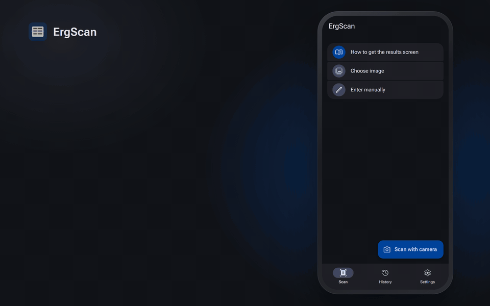

# ErgScan: Concept2 PM5 photo to Strava and Garmin



**Turn a photo of your Concept2 rowing machine monitor into a FIT file for
Strava, Garmin Connect or intervals.icu.** ErgScan is a free, open-source web
app that reads the results screen of a Concept2 PM5 or PM4 performance monitor
with OCR, lets you check the splits, and exports the indoor rowing workout
with every split or interval, pace, stroke rate, watts and heart rate.

No Bluetooth pairing, no ErgData and no account needed: row first, photograph
the screen afterwards. Works with the Concept2 RowErg (Model D and Model E)
on iPhone, Android and desktop.

Photos and text recognition stay on your device. Workouts are saved in your
browser and the app keeps working offline once it has been opened. Deployments
with private sync enabled can share saved workouts across linked devices
using end-to-end encryption.

## Features

- Take a photo of the PM4/PM5 results screen, or pick an image you already have.
  A step-by-step guide shows how to reach the results screen on a PM5 or PM4.
- Finds the LCD in the image before reading it, so cropped photos and
  screenshots of social media posts work as well as close-ups.
- Offline OCR with [Tesseract.js](https://github.com/naptha/tesseract.js),
  with image thresholding to cope with glare and uneven light on the LCD.
- Parses the PM4/PM5 table: time, meters, split (/500m or /1000m), stroke rate,
  and heart rate, watts or calories. Rest intervals are detected.
- Long workouts that do not fit on one screen: when the splits fall short of
  the total, scroll the monitor down and scan the next rows. Rows shared by
  both photos are kept once.
- Editable review table to fix anything the OCR got wrong, add or remove rows,
  set the start time and recalculate the total. Unsaved edits survive a reload.
- Time in heart rate zones (60/70/80/90% of max) on the result page, using a
  measured max heart rate or one estimated from your age.
- Reads the drag factor and keeps it with the workout.
- Name workouts and add notes; both are written into the FIT file.
- Rate how you felt, from weary to beaming. The face shows in the history list
  and goes into the FIT file as the session's workout feel.
- Local workout history and optional encrypted sync between linked devices.
- FIT export as an indoor rowing activity: one lap per split or interval, rest
  laps marked as rest, and per-lap distance, stroke rate, power and heart rate.
  Power is derived from pace when the screen has no watts column.
- Manual entry when no photo is at hand.
- Settings for light or dark theme, accent color, heart rate, hiding the intro
  card and clearing all app data.
- Installable Material 3 PWA in English and Danish, with a bottom bar on phones
  and a navigation rail on wide screens.

## Taking a good photo

- Hold the phone straight in front of the screen, not at an angle.
- Let the table fill most of the frame.
- Avoid reflections on the digits.

## FAQ

### How do I get a Concept2 rowing workout into Strava without ErgData?

Take a photo of the PM5 or PM4 results screen after the workout, check the
splits in ErgScan, and share or download the FIT file. Upload that file to
Strava, Garmin Connect or intervals.icu. Each split keeps its distance, pace,
stroke rate, power and heart rate.

### I forgot to connect my phone or watch before rowing. Can I still log the workout?

Yes. As long as the workout is in the monitor's memory, open it from the
PM5 or PM4 memory menu, photograph the results screen and export it. The
in-app guide shows where to find it.

### Does it work with interval workouts?

Yes. Each interval becomes its own lap, and rest intervals are exported as
rest laps.

### Do I need to install an app?

No. ErgScan is a progressive web app that runs in the browser. You can add it
to the home screen and use it offline.

### Is it free?

Yes, free and open source under the MIT license, with no ads, accounts or
tracking.

## Development

Requires Node.js 20.19+ or 22.12+.

```sh
npm install
npm run dev        # start the dev server
npm run check      # typecheck and run the tests
npm run build      # production build in dist/
npm run preview    # serve the production build
npm run eval       # score OCR and parsing against the labelled test images
```

`npm run dev` and `npm run build` copy the Tesseract worker, wasm core and
English model from `node_modules` into `public/tesseract/`, so the app never
loads OCR files from a CDN.

### OCR evaluation

`testdata/` holds photos and screenshots of PM4/PM5 results screens, each with
a JSON file describing what the screen shows and the workout it should parse
to. `npm run eval` runs the same preprocessing and OCR as the app on every
image in Node and prints per-image scores for OCR cells, rows, workout fields
and lap counts. Workouts photographed across several scrolled screens are
described in `testdata/multi/`; their photos are merged in order and scored
against the whole workout. Results are saved to `eval-results/` (ignored by git).

Useful flags, passed after `--`:

| Flag | Effect |
| --- | --- |
| `--only <text>` | Only images whose name contains the text |
| `--sens <n>`, `--blur <n>`, `--long <n>`, `--crop <n>` | Override a preprocessing option |
| `--framed` | Skip screen detection and use the labelled screen position |
| `--show` | Print the OCR text |
| `--dump` | Write the preprocessed images to `eval-results/images/` |
| `--label <name>` | Add a label to the saved result file name |

### Docker

The `Dockerfile` builds the app and serves `dist/` with nginx on port 80:

```sh
docker build -t ergscan .
docker run -p 8080:80 ergscan
```

### Private sync

For local development, run `npm run sync:serve` with Node.js 24 alongside
`npm run dev`. Vite proxies `/api/sync/*` to port 8787. Set
`ERGSCAN_SYNC_DB` to choose where the server stores its SQLite file.

For a sync-enabled deployment, run:

```sh
docker compose -f compose.sync.yml up --build -d
```

The stack listens on `127.0.0.1:8080`. In production, serve it through an HTTPS
reverse proxy on one origin. The database lives in a named volume. Configure
rate limits and storage monitoring at the deployment, and apply a documented
retention policy to any database backups. Deleting a vault removes the live
server copy and revokes its credentials. Copies previously downloaded to other
devices and copies in backups follow their own retention.

Enable sync on the device with your existing history and save the generated
recovery key. On the second device, open **Settings → Private sync → Link this
device**. Scan its QR code or paste the displayed pairing code into Settings
on the first device, then approve the link. Recovery on a new device requires
the recovery key and access to the same sync deployment.

Sync sends an encrypted snapshot of saved history, including workout notes,
splits, and heart rate when recorded. Photos, raw OCR output, drafts, and
settings stay local. The server handles device credentials and can observe
request timing and encrypted payload size. Browser storage and the app code
served by the deployment are trusted by linked devices.

Workouts always save locally first. Sync runs when connected and the app is
open. The server accepts encrypted history payloads of up to 8 MiB. Past this
limit, ErgScan keeps saving locally and shows the pending sync state.

### Project layout

| Path | Purpose |
| --- | --- |
| `src/core/` | Framework-free logic: time parsing, PM4/PM5 parser, workout model, FIT export, heart rate zones, history, settings, routing |
| `src/ocr/` | Screen detection, image preprocessing, Tesseract worker and OCR asset caching |
| `src/components/` | Vue components: camera, review table, PM guide, Material 3 dialogs and menus |
| `src/ui/` | Framework-free UI behavior: icons, menus, ripples, transitions, confirm dialogs |
| `src/locales/<lang>/i18n.json` | Translations; every locale must have the same keys |
| `testdata/` | Labelled results-screen images for tests and `npm run eval` |
| `scripts/` | Build helpers, the OCR evaluation script and the README animation: with `npm run build && npx vite preview --port 4317` running, `node scripts/readme-demo/capture.mjs` screenshots the app and `node scripts/readme-demo/render.mjs` renders the GIF (needs Chrome; a Playwright Chromium is found on its own) |

### Adding a language

Create `src/locales/<code>/i18n.json` with the same keys as
`src/locales/en/i18n.json` and register it in `src/i18n.ts`. A test fails if a
locale is missing keys.

## Limitations

- OCR accuracy depends heavily on the photo. Always check the review table
  before exporting.
- The PM4 and PM5 do not show a per-stroke history on the results screen, so the FIT
  file has per-lap values with evenly spaced samples within each lap, not
  stroke-by-stroke data.

## License

[MIT](LICENSE).

The FIT export uses the [Garmin FIT JavaScript SDK](https://github.com/garmin/fit-javascript-sdk),
which is distributed under the FIT Protocol License.

ErgScan is an independent project and is not affiliated with or endorsed by
Concept2 or by the makers of the ErgScan app on the App Store and Google Play.
